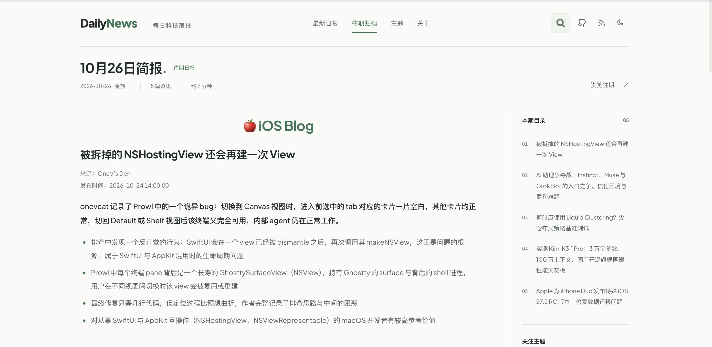
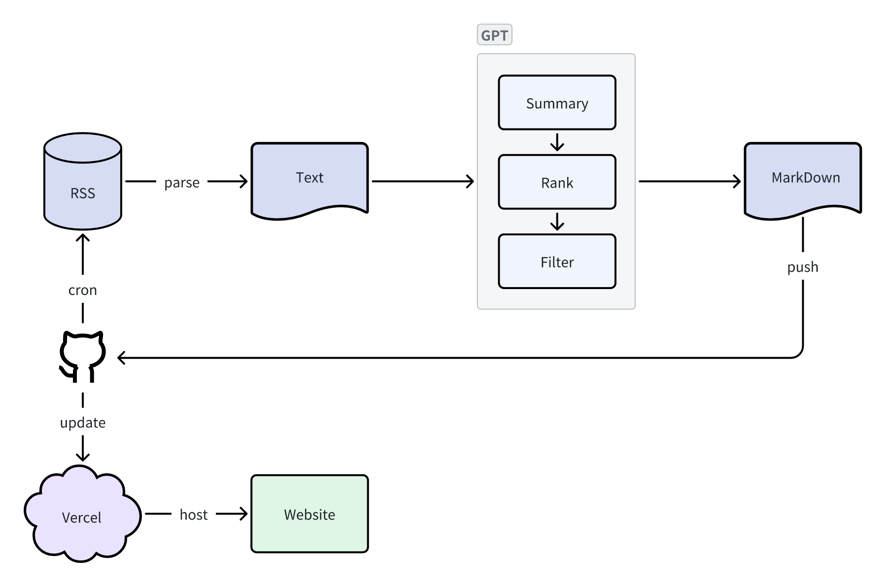

# AIDailyNews

把你关注的 RSS，变成一份每天可读的科技简报。

AIDailyNews 使用 Python 采集订阅内容，通过 AI 评分、筛选并生成中文摘要，再由 Astro 展示为可搜索、可归档的日报。你可以直接阅读现有站点，也可以 Fork 仓库，搭建自己的信息源与日报网站。

[在线阅读](https://daily.zhangferry.com) · [本地预览](#本地预览) · [生成自己的日报](#生成自己的日报) · [部署网站](#部署网站)

[](docs/ui-review/screenshots/readme-desktop.png)

<sub>Retina 实机截图（2916 × 1424），点击查看原图。</sub>

## 项目特点

- **自定义信息源**：按分类管理 RSS，支持读取订阅摘要、提取原文，以及通过 GitHub API 获取仓库 README。
- **AI 筛选与总结**：支持 OpenAI 兼容接口和 Gemini；按评分筛选文章，生成标题、摘要和主题标签。
- **专注阅读**：紧凑的刊期信息、吸顶导航、桌面侧边目录与手机折叠目录，保留来源链接和配图。
- **查找往期内容**：提供日报归档、主题浏览与全文搜索，支持深浅色切换。
- **自动更新**：GitHub Actions 定时采集，将日报以 Markdown 提交到仓库，连接 Vercel 后触发网站部署。

## 工作方式

[](docs/images/workflow.png)

1. **采集**：GitHub Actions 定时触发 Python 流程，解析 RSS 并提取文章内容。
2. **整理**：AI 生成摘要与评分，程序筛选入选文章，按分类写入 Markdown 日报并推送仓库。
3. **发布**：Vercel 在仓库更新后部署 Astro 网站，读者可浏览日报、搜索全文或订阅 RSS。

采集与展示可以分别运行。只想修改页面时，直接使用仓库中的历史日报，无需配置 AI API Key。

当前 [GitHub Actions](.github/workflows/main.yml) 的定时表达式为 `0 15 * * *`，即北京时间每天 **23:00**；也支持手动触发。采集默认回看最近 24 小时，并限制在上海时区的当天与前一天。生成的日报以次日为刊期，便于第二天阅读。

## 本地预览

准备 Node.js 22+ 和 Yarn 1.x，然后运行：

```bash
git clone https://github.com/zhangferry/AIDailyNews.git
cd AIDailyNews
yarn install
yarn dev
```

打开终端提示的本地地址，默认是 `http://localhost:4321`。开发启动与生产构建前会自动生成搜索索引。

常用命令：

| 命令 | 用途 |
| --- | --- |
| `yarn dev` | 启动本地开发服务器 |
| `yarn build` | 构建生产版本，当前使用 Vercel 服务端适配器 |
| `yarn check:type` | TypeScript 类型检查 |
| `yarn lint` | 检查源码规范 |
| `node --test scripts/tests/*.test.mjs` | 验证阅读布局转换与历史日报内容保留 |

## 生成自己的日报

### 1. Fork 仓库并设置订阅

Fork 本仓库，修改 [workflow/resources/rss.json](workflow/resources/rss.json)。可以保留历史日报用于预览；需要从自己的内容开始时，再清理 `src/content/blog/` 中的示例日报，并保留该目录。

下面是可直接使用的 JSON 结构示例：

```json
{
  "configuration": {
    "rsshub_domain": "https://your-rsshub.example.com/"
  },
  "categories": [
    {
      "category": "技术博客",
      "items": [
        {
          "title": "Swift.org",
          "url": "https://www.swift.org/atom.xml",
          "input_count": 4,
          "output_count": 2,
          "image_enable": true
        }
      ]
    }
  ]
}
```

| 字段 | 说明 |
| --- | --- |
| `category` | 网页中的分类标题 |
| `title` | 信息源名称 |
| `url` | RSS 地址 |
| `type` | 不填时读取 RSS 内容；`link` 提取原文；`code` 通过 GitHub API 获取仓库 README |
| `input_count` | 每个源最多采集的文章数，默认 `4` |
| `output_count` | 每个源期望输出的文章数，默认 `2`；满分文章可突破此值，最终仍受日报总数限制 |
| `lookback_hours` | 该源的回看小时数，优先于全局配置，仍限制在当天与前一天 |
| `image_enable` | 是否从 RSS 提取配图，默认 `false` |
| `rsshub_path` | 可选；与 `configuration.rsshub_domain` 拼接，设置后覆盖 `url` |

使用普通 RSS 时无需配置 RSSHub；使用 `rsshub_path` 时，请填写自己的 RSSHub 服务地址。

### 2. 配置 AI 并在本地生成

准备 Python 3.12，创建虚拟环境并安装依赖：

```bash
python3 -m venv .venv
source .venv/bin/activate
python3 -m pip install -r requirements.txt
cp .env.example .env
```

在 `.env` 中配置 AI。下面使用 OpenAI 兼容接口，替换占位内容后再运行：

```dotenv
AI_PROVIDER=openai
GPT_API_KEY=your-api-key
GPT_BASE_URL=https://your-provider.example.com/v1
GPT_MODEL_NAME=your-model-name
MAX_ARTICLE_NUMS=12
```

`GPT_BASE_URL` 应填写服务商提供的完整 OpenAI 兼容 API 基础地址。模板中的旧字段 `GPT_BASE_HOST` 不被当前代码读取，请使用 `GPT_BASE_URL`。

| 变量 | 说明 |
| --- | --- |
| `AI_PROVIDER` | `openai` 或 `gemini`；GLM 等兼容服务使用 `openai` |
| `GPT_API_KEY` | 对应服务的 API Key，生成日报必填 |
| `GPT_BASE_URL` | OpenAI 兼容接口基础地址；Gemini 分支不使用此值 |
| `GPT_MODEL_NAME` | OpenAI 兼容接口使用的模型名称，建议显式设置 |
| `MAX_ARTICLE_NUMS` | 每期最多保留的文章数，默认 `12` |
| `MIN_ARTICLE_SCORE` | 最低入选评分，默认 `6` |
| `RSS_LOOKBACK_HOURS` | 全局回看小时数，默认 `24` |
| `BLOCKED_ARTICLE_KEYWORDS` | 以英文逗号分隔的过滤词；默认过滤破解、盗版等内容 |

Gemini 使用 `AI_PROVIDER=gemini` 和对应的 `GPT_API_KEY`。当前请求代码固定调用 `gemini-2.5-flash`，修改 `GPT_MODEL_NAME` 不会改变实际调用的 Gemini 模型；如需调整，修改 [workflow/gpt/request.py](workflow/gpt/request.py)。

在仓库根目录运行：

```bash
python3 main.py
```

日报写入 `src/content/blog/dailyNews_YYYY-MM-DD.md`，同时更新 `src/config/config.json` 中的模型信息。如果没有文章通过筛选，流程会报错，不生成空日报。生成后重新启动开发服务器，可同步更新搜索索引。

### 3. 开启 GitHub Actions 自动采集

1. 在 Fork 仓库的 **Settings → Secrets and variables → Actions** 中添加以下 Repository secrets。
2. 修改 [.github/workflows/main.yml](.github/workflows/main.yml) 中的 `AI_PROVIDER`、`GPT_BASE_URL`、`GPT_MODEL_NAME` 和采集参数，匹配自己的服务。
3. 在 **Actions → CI → Run workflow** 手动运行一次，确认日报成功生成并提交。

| Secret | 用途 |
| --- | --- |
| `GPT_API_KEY` | AI 服务密钥 |
| `GIT_NAME` | 日报自动提交使用的 Git 用户名 |
| `GIT_EMAIL` | 日报自动提交使用的 Git 邮箱 |
| `ACCESS_TOKEN` | 用于推送日报，需有目标仓库的内容写入权限 |

当前工作流也会在面向 `main` 的 push 和 PR 上执行采集，仅在 `main` 分支推送生成结果。采集首次失败后会等待 10 分钟重试一次；如需调整时间或触发条件，修改同一工作流文件。

## 部署网站

[](https://vercel.com/new/clone?repository-url=https%3A%2F%2Fgithub.com%2Fzhangferry%2FAIDailyNews)

在 Vercel 导入自己的 Fork 仓库，使用 Astro 框架预设，安装命令设为 `yarn install`，构建命令设为 `yarn build`。当前配置使用 Vercel 服务端适配器。

部署前修改 [src/config.ts](src/config.ts) 的站点地址、仓库地址和作者信息，并同步 [astro.config.mjs](astro.config.mjs) 中的 `site`。GitHub Actions 将新日报推送到所连接的分支后，由 Vercel 自动部署。

仅展示已有日报不需要 AI Key；自动采集所需的密钥放在 GitHub Actions secrets 中。评论为可选功能，未完整配置时不会初始化，相关字段见 [src/components/Prose.astro](src/components/Prose.astro)。

## 项目结构与定制

| 路径 | 用途 |
| --- | --- |
| `workflow/resources/rss.json` | 信息源与分类 |
| `workflow/mainflow.py` | 采集、筛选与生成流程 |
| `workflow/gpt/` | AI 请求、提示词与摘要逻辑 |
| `src/content/blog/` | Markdown 日报内容 |
| `src/components/DailyBrief.astro` | 首页与历史日报共用的阅读界面 |
| `src/styles/brief.css` | 阅读布局、字体层级与响应式样式 |
| `src/plugins/news-layout.mjs` | 历史日报 Markdown 的渲染兼容 |
| `src/config.ts` | 导航、站点信息与功能开关 |
| `src/config/config.json` | 站点名称与采集时同步的模型信息 |
| `scripts/search/prepare-index.js` | 搜索索引生成 |
| `scripts/tests/` | 阅读布局与内容保留回归测试 |

界面改版的设计与验证记录见 [UI 评估文档](docs/ui-review/review.md)。Python 中的部分 `test_*.py` 是需要网络、AI 凭据或本地资源的调试脚本，运行前请检查对应文件的配置。

## 致谢与许可

页面基于 [astro-ink](https://github.com/one-aalam/astro-ink) 定制，使用 Astro、Svelte 与 Tailwind CSS。项目以 [MIT License](LICENSE) 开源。
