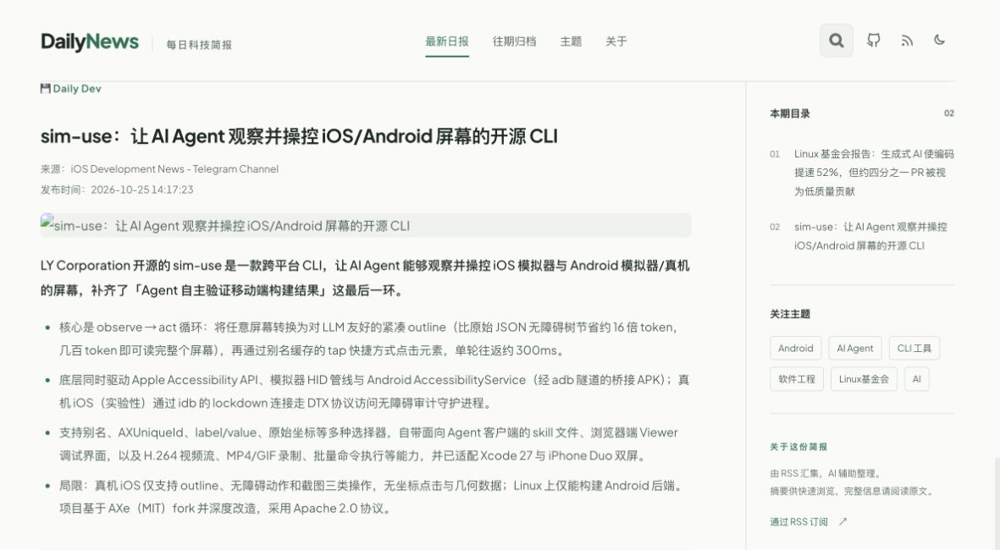
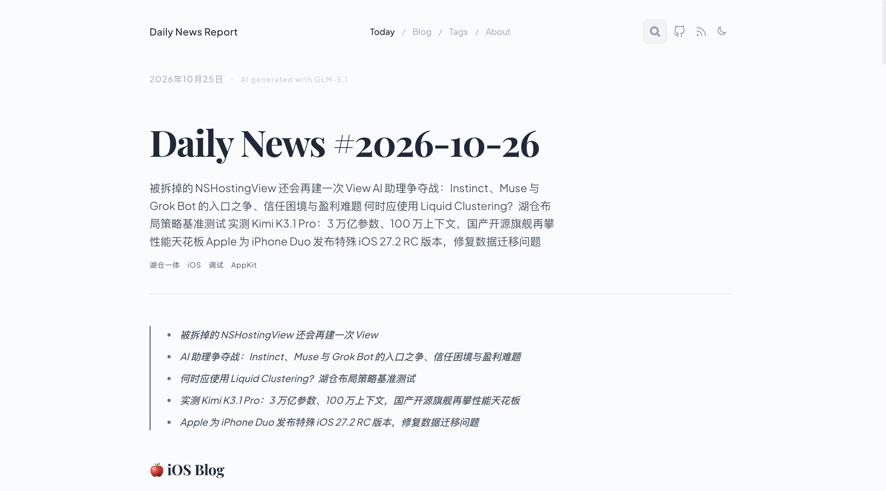
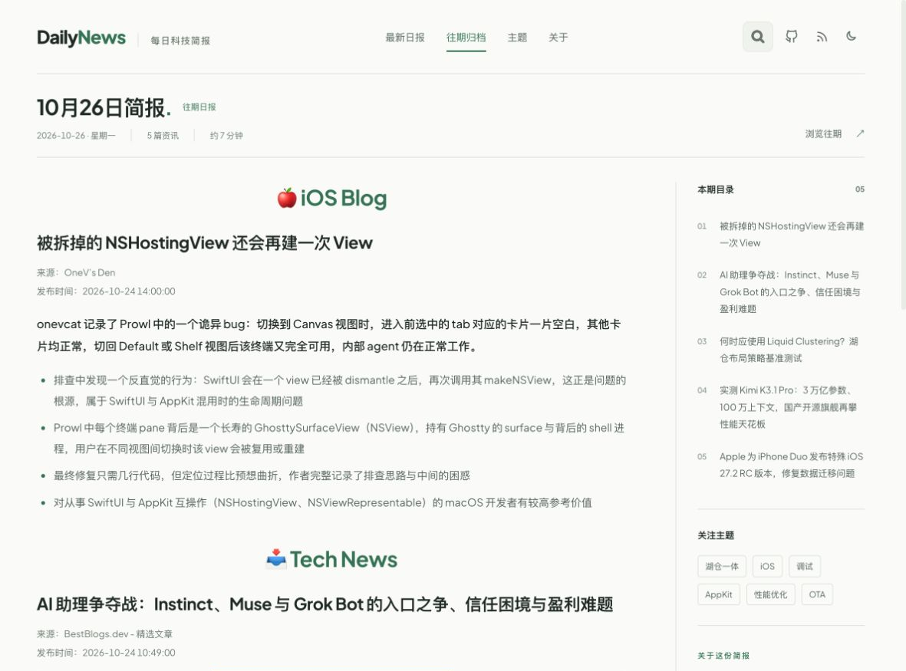
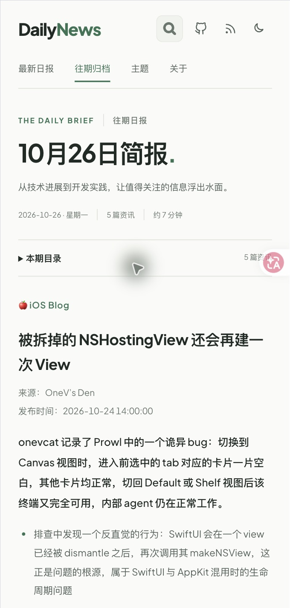

# AIDailyNews · 阅读界面改版

## 项目理解

RSS → Python 采集与 AI 总结 → Markdown → Astro 页面，搜索与主题切换由 Svelte 提供。本次保留现有技术栈、数据和路由，改善新闻阅读与历史浏览。

## 源码评估与对应改进

| 原有问题 | 改进 |
| --- | --- |
| 来源、发布时间、图片、摘要混在普通段落里 | 在 Markdown 渲染阶段分离元信息、图片和正文；兼容历史文档，不修改原始新闻 |
| 正文横跨页面，分类和文章边界不明显 | 固定阅读栏宽度，统一标题、正文、分隔线、段落与列表间距 |
| 导读是斜体引用列表，长文难定位 | 桌面旁栏目录；手机折叠目录；标题锚点保持稳定 |
| 二十多个标签占据文章开头 | 少量主题放在旁栏，全部主题移至文末折叠区域 |
| 首页日期与所展示文章可能不是同一天 | 按实际刊期显示日期、星期、文章数与估算阅读时间，明确标为最新一期 |
| 归档重复显示标题，三列 flex 宽度加间距易换行 | 单一页标题、两列 Grid、明确的日期列与列表分隔 |
| 移动端品牌、导航和工具争夺同一行空间 | 手机导航独立一行，保留搜索、RSS 与主题操作 |
| Tailwind 没有扫描 Svelte 组件 | 补充 Svelte 扫描范围，确保交互组件样式进入构建 |
| 搜索索引只在构建后更新，部署时会复制旧索引 | 改为开发启动/构建之前生成；索引由 690 篇更新至当前 842 篇 |

视觉采用纸白、深墨文字和单一绿色强调色；正文使用中文无衬线字体，减少长段落粗体负担；配图保留完整比例并限制高度。深色模式使用对应的墨绿灰色系。

## 最终阅读层级

- 顶部菜单吸顶；自动测量导航高度，为目录停靠与锚点跳转预留空间；搜索弹层覆盖导航。
- 刊期区精简为两行，去掉英文眉题和宣传语；桌面实测约 109px 高。
- 分类标题在正文栏居中：桌面 28px、手机 24px；文章标题保持左对齐，分别为 22px / 20px。
- 移除每篇文章与分类前后的横线，改用留白分组。
- 首页与历史文章共用 `DailyBrief`，避免两套页面样式漂移。

## 关键文件

- `src/components/DailyBrief.astro`：首页与文章页共享的阅读界面。
- `src/styles/brief.css`：阅读布局、桌面与移动端样式。
- `src/plugins/news-layout.mjs`：历史 Markdown 的兼容转换。
- `src/pages/index.astro`、`src/layouts/post.astro`：复用共享界面，删除重复布局。
- `src/components/Header.astro`、`PostPreviewList.astro`：导航与归档修复。
- `scripts/tests/`：结构回归及全量内容保留检查。

## 验证

- 5/5 测试通过。覆盖 842 篇日报，确认正文、6,453 个原始外链、809 张图片均保留。
- 类型检查通过。
- 生产构建通过；修复前后篇导航依赖的旧图标包在 Astro 5 构建时的类型导出错误，以文字箭头表达导航。
- 7 个本地页面 HTTP 200：首页、归档、三个不同时期日报、主题、关于；每页一个 h1，目录与跳转正文的锚点全部有效。
- lint 与改版前相同，仍有 6 条既有诊断（涉及 RSS、通用工具、Markdoc 链接 schema），未扩大到无关清理。
- `git diff --check` 通过。

## 预览与边界

运行 `npm run dev -- --host 127.0.0.1`，本地预览位于 http://127.0.0.1:4321/ 。

已在 Chrome 中完成实际视觉与交互检查：

1. 原版与改版使用同一期（2026-10-26）对照，确认重复导读移出首屏，正文更早出现。
2. 桌面目录点击后定位到对应文章，滚动时旁栏保持可用。
3. 390×844 模拟手机视口：导航分行、目录展开/收起及文章定位正常；长标题与正文没有横向溢出。
4. 手机搜索 SwiftUI，返回 30 篇结果，弹层宽度适配并支持滚动；Escape 可关闭。
5. 深浅色模式可来回切换，文字、分隔线和目录保持可读。
6. 归档双列排列正常，导航可切回最新日报。
7. 未配置 Gitalk 时不再初始化评论，避免预览出现 Not Found；生产环境有完整配置时保留原评论服务。
8. 本地开发同时构建时触发过文件句柄不足；已让开发 watcher 忽略 .vercel 构建产物，并重新启动验证。

[搜索截图](screenshots/mobile-search.png) · [深色截图](screenshots/mobile-dark.png) · [归档截图](screenshots/archive.png)

以上为 Chrome 桌面及设备模拟检查，未覆盖 Safari、真实手机或完整无障碍合规审计。截图中的粉色浮动图标来自浏览器翻译扩展。

本次修改位于 `ui/daily-brief-reading` 分支，通过 PR 交付；尚未合并主分支。
